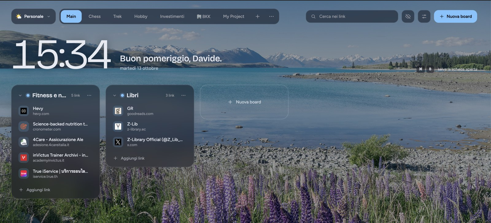
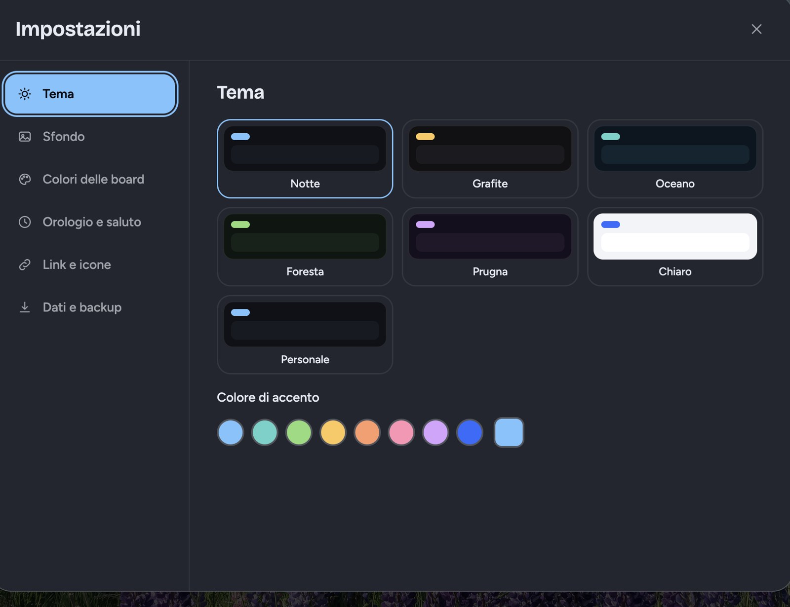
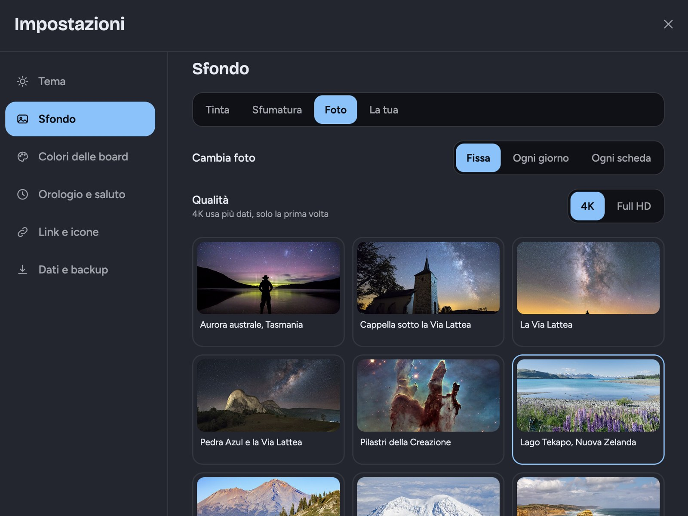

# Boards — nuova scheda segnalibri

Estensione Chrome (Manifest V3) che sostituisce la nuova scheda con i tuoi segnalibri organizzati in **board**.
Pensata per uso personale: **tutto resta in locale** (`chrome.storage.local` e IndexedDB), nessun cloud, nessun account.



<p align="center">
  
  
</p>

## Come è organizzato

```
Workspace  (es. 🌤️ Personale, 💼 Lavoro)
 └─ Pagina  (le schede in alto: Main, Chess, Trek…)
     └─ Board  (le colonne)
         └─ Link
```

## Funzioni

- **Workspace, pagine, board e link**, con trascinamento (link tra board e pagine, board tra pagine, pagine per cambiarne l’ordine).
- **Link**: evidenzia con un colore, fissa in alto, duplica, sposta, promemoria con notifica ("Ricordamelo").
- **Board**: comprimi, blocca, ordina A–Z, "Apri tutte le pagine".
- **Impostazioni** (finestra centrale): temi e colore di accento personalizzabili, colori delle board, orologio e saluto, icone, larghezza colonne.
- **Sfondi**: tinta unita, sfumature, foto 4K da Wikimedia Commons (fisse o a rotazione), oppure una tua foto.
- **Importazione guidata**: dai segnalibri di Chrome o da un file HTML (Chrome, Edge, Firefox, Safari). Scegli come organizzarli (segui le tue cartelle, un modello di pagine per argomento, oppure tutto in «Da smistare»), controlli l'anteprima ad albero (rinomini, sposti, togli la spunta) e, se vuoi, smisti i link incerti uno alla volta con la tastiera. Il classificatore è locale (dominio, parole del titolo, cartella d'origine) e impara dalle tue scelte; nulla viene scritto finché non premi «Importa», e `Ctrl+Z` annulla tutto. Al primo avvio ti chiede il nome e da dove vuoi cominciare.
- **Board «To-do»** (facoltativa, menu ⋯ della pagina): mostra in sola lettura i to-do aperti del tuo Second Brain, ordinati per priorità, leggendoli dal suo server MCP (o da un'API JSON). Indirizzo e token si inseriscono in Impostazioni → To-do, restano sul computer e non finiscono nei backup; il permesso per contattare il server viene chiesto solo lì.
- **Cerca e salta** con `Ctrl+K` (`⌘K`): workspace, pagine, board e link in un'unica ricerca; a campo vuoto mostra i link più usati. `/` porta alla ricerca nella pagina.
- **Più usati**: un contatore locale delle aperture permette di ordinare una board «per più usati».
- **Annulla / Ripeti** (`Ctrl+Z`, `Ctrl+Shift+Z`) per qualsiasi modifica a link, board, pagine e workspace, oltre al pulsante «Annulla» negli avvisi.
- **Doppioni**: avviso quando salvi un indirizzo già presente (anche scritto in modo diverso: `www`, `http`/`https`, parametri `utm`…) e finestra «Trova i link doppi».
- **Link rotti**: controllo su richiesta (o ogni settimana, in background) con segnalazione accanto al link; permesso «accesso ai siti» chiesto solo quando lo attivi.
- **Popup** `Ctrl+B` (`⌘B` su Mac) per salvare la scheda aperta, oppure «Tutte le schede» per salvarle tutte in una nuova board.
- **Dati**: backup/ripristino JSON, copie automatiche giornaliere (ultime 5), **backup in una cartella** a tua scelta (es. dentro Google Drive o Dropbox: una copia al giorno, ultime 10), modalità privacy.

## Installazione (modalità sviluppatore)

1. Scarica lo ZIP dell'ultima [release](../../releases/latest) (oppure clona il repository) e, se serve, decomprimilo.
2. Apri `chrome://extensions` e attiva **Modalità sviluppatore**.
3. **Carica estensione non pacchettizzata** e scegli la cartella del repository.

Il campo `key` nel `manifest.json` è la chiave **pubblica** che fissa l'ID dell'estensione
(`mcefhihpfnhjjkkfolcmgjdmicpocpaf`): spostando la cartella i dati restano.

## Permessi

| Permesso | Perché |
| --- | --- |
| `storage`, `unlimitedStorage` | dati e copie automatiche in locale |
| `activeTab` | il popup legge titolo e indirizzo della scheda da salvare |
| `favicon` | icone dei siti dalla cache di Chrome |
| `alarms`, `notifications` | promemoria dei link |
| `bookmarks` (opzionale) | richiesto solo quando importi i segnalibri di Chrome |
| `tabs` (opzionale) | richiesto solo quando premi «Tutte le schede» nel popup |
| accesso a un sito (opzionale) | richiesto solo quando colleghi il Second Brain, limitato al suo indirizzo |
| accesso ai siti (opzionale) | richiesto solo per il controllo dei link rotti; l'estensione contatta soltanto gli indirizzi che hai salvato |

Le foto di sfondo sono caricate da `commons.wikimedia.org` solo se scegli uno sfondo "Foto".

## Struttura

| File | Ruolo |
| --- | --- |
| `newtab.html/js/css` | pagina principale: board, trascinamento, import, sfondi |
| `settings.js/css` | finestra delle impostazioni |
| `workspaces.js` | finestra dei workspace |
| `store.js` | modello dati, sanificazione, archivio, copie automatiche |
| `catalog.js` | temi, colori, sfumature e catalogo delle foto |
| `theme.js`, `ui.js`, `base.css` | tema, componenti (menu, finestre, avvisi), stili base |
| `palette.js` | ricerca e salto con `Ctrl+K` |
| `todo.js` | board To-do: client MCP/JSON e normalizzazione |
| `tools.js`, `health.js` | doppioni e controllo dei link rotti |
| `importer.js`, `classify.js`, `learned.js`, `wizard.js` | importazione guidata: lettura dei segnalibri, classificatore locale, regole apprese, procedura a passi |
| `tests/` | prove della logica pura (`node --test`) |
| `scripts/build-zip.sh` | crea lo ZIP da allegare a una release |
| `backupdir.js` | backup automatico in una cartella |
| `popup.*` | popup di salvataggio rapido |
| `background.js` | service worker: promemoria e controllo settimanale dei link |

## Release

Ogni versione ha un tag `vX.Y.Z` e una [release](../../releases) con lo ZIP pronto da caricare in `chrome://extensions`. Per pubblicarne una: aggiorna `version` nel `manifest.json`, fai il commit e carica il tag (`git tag vX.Y.Z && git push origin vX.Y.Z`). Il workflow `.github/workflows/release.yml` controlla che tag e versione coincidano, esegue le prove, crea lo ZIP con `scripts/build-zip.sh` e lo allega alla release. (In alternativa si può creare la release dal sito: lo ZIP viene allegato in automatico.)

## Crediti foto

Le foto sono su Wikimedia Commons; autore e licenza compaiono in basso a destra quando una foto è attiva
e nel catalogo (`catalog.js`): Jamen Percy, Benh Lieu Song, Ian Norman, Eduardo M S Neves,
NASA/ESA/Hubble Heritage Team, Krzysztof Golik, Frank Schulenburg, TA Gonsalves, Dietmar Rabich, King of Hearts,
Diego Delso, Dmytro Balkhovitin, George Chernilevsky, Martin Falbisoner, ESO/J. Colosimo, NASA/ESA/J. Hester e A. Loll, NASA/ESA/M. Robberto (licenze CC BY 4.0, CC BY-SA 2.0/3.0/4.0 o pubblico dominio).

I caratteri Bricolage Grotesque e Figtree sono sotto licenza SIL Open Font License.
